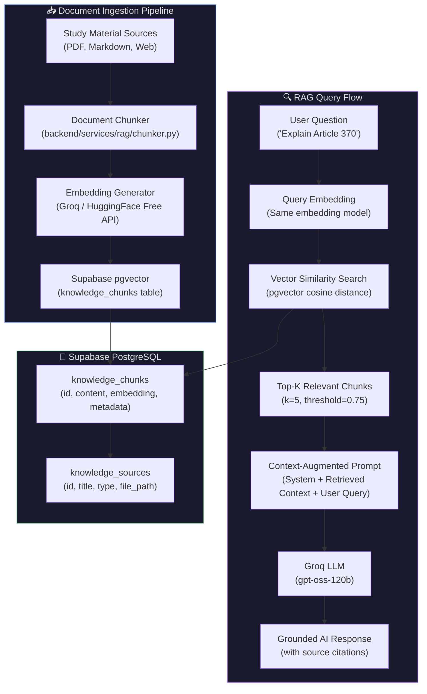
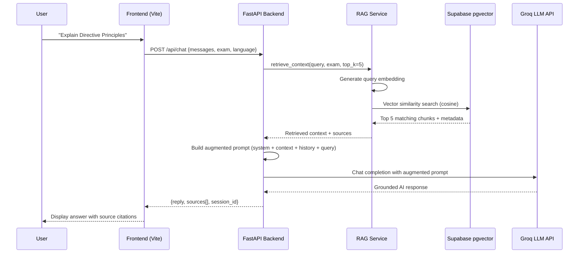

# Implementation Plan: RAG Architecture for ParikshAI

## Goal Description

ParikshAI is an AI-powered Government Exam preparation platform (UPSC, SSC, GPSC, RRB, State PSC) that currently uses the **Groq API** to answer student questions and generate MCQs. The AI relies entirely on its **parametric knowledge** (model training data) — it has no access to actual study materials, syllabus documents, NCERT textbooks, previous year papers, or current affairs.

**What RAG accomplishes:**
- Ground AI responses in **verified, authoritative study material** (NCERT, Laxmikant, IGNOU notes, official syllabi)
- Enable **current affairs** integration (news, government gazette notifications, PIB)
- Improve MCQ quality by generating questions from **actual reference material** rather than the model's memory
- Provide **source citations** so students can verify and study further
- Reduce AI hallucinations on factual exam topics

---

## Recommended Architecture: Supabase pgvector RAG

> [!IMPORTANT]
> **Why Supabase pgvector over Pinecone/Weaviate/ChromaDB:**
> - ParikshAI already uses **Supabase PostgreSQL** — pgvector is a free extension, zero additional infrastructure
> - No new hosting costs (\$0)
> - No new API keys or vendor lock-in
> - Co-located with existing data — joins between vector search results and user data (weak_topics, progress) are a single query
> - Supabase's free tier supports pgvector with up to 500MB storage (enough for ~100K document chunks)

### Architecture Diagram



### Data Flow (Sequence)



---

## User Review Required

> [!WARNING]
> **Embedding Model Choice — Free Tier Constraint:**
> Since the project uses free-tier services, the plan uses one of these **free embedding options**:
> 1. **Sentence Transformers (local)** — `all-MiniLM-L6-v2` (384 dimensions, runs on CPU, completely free, no API calls)
> 2. **Groq embeddings** — If/when Groq adds embedding endpoints
> 3. **HuggingFace Inference API** — Free tier with rate limits
>
> **Recommendation**: Option 1 (local Sentence Transformers) is the most reliable and truly free approach. It adds ~80MB to backend memory but has zero API costs and zero rate limits.

> [!IMPORTANT]
> **Study Material Sourcing:**
> The RAG system is only as good as the documents fed into it. The plan includes a document ingestion pipeline, but **you need to supply the actual study materials**:
> - NCERT textbooks (Class 6-12 for History, Geography, Polity, Economics, Science)
> - Laxmikant's Indian Polity notes (if you have digital versions)
> - Previous year question papers with explanations
> - Current affairs compilations
> - Official exam syllabi (UPSC, SSC, GPSC, RRB)
>
> These should be placed in `backend/data/knowledge/` as PDF, Markdown, or plain text files.

---

## Open Questions

> [!IMPORTANT]
> 1. **Which embedding model do you prefer?**
>    - **(a) Local Sentence Transformers** (`all-MiniLM-L6-v2`, 384d) — Free, no API, works offline, ~80MB RAM
>    - **(b) HuggingFace Inference API** — Free tier, requires internet, has rate limits
>    - **(c) Groq/OpenAI embeddings** — Requires paid API key
>
> 2. **Should RAG be applied to both Chat AND MCQ generation, or Chat only?**
>    - Chat: Grounded answers with source citations
>    - MCQ: Generate questions from actual textbook content (higher quality, syllabus-aligned)
>
> 3. **How should source citations be displayed?**
>    - **(a)** Inline references: "According to NCERT Class 11 Political Science [1]..."
>    - **(b)** Footer section: Sources listed at the bottom of each response
>    - **(c)** Both

---

## Proposed Changes

### Component 1: Database — Supabase pgvector Schema

#### [NEW] `supabase/migrations/202610280001_rag_knowledge_base.sql`

Enable pgvector and create the knowledge base tables:

```sql
-- Enable the pgvector extension for vector similarity search
CREATE EXTENSION IF NOT EXISTS vector;

-- ─────────────────────────────────────────────────────────
-- Table: knowledge_sources
-- Tracks the origin of each ingested document
-- ─────────────────────────────────────────────────────────
CREATE TABLE IF NOT EXISTS public.knowledge_sources (
  id UUID PRIMARY KEY DEFAULT gen_random_uuid(),
  title TEXT NOT NULL,
  source_type TEXT NOT NULL CHECK (source_type IN ('ncert', 'notes', 'pyq', 'current_affairs', 'syllabus', 'custom')),
  subject TEXT NOT NULL,          -- 'Indian Polity', 'Geography', 'History', etc.
  exam_tags TEXT[] DEFAULT '{}',  -- {'UPSC', 'SSC', 'GPSC'} — which exams this is relevant for
  file_path TEXT,                 -- Original file path or URL
  file_hash TEXT,                 -- SHA-256 hash to prevent duplicate ingestion
  chunk_count INTEGER DEFAULT 0,
  metadata JSONB DEFAULT '{}',    -- Additional metadata (author, edition, year, etc.)
  created_at TIMESTAMPTZ NOT NULL DEFAULT NOW(),
  updated_at TIMESTAMPTZ NOT NULL DEFAULT NOW()
);

-- ─────────────────────────────────────────────────────────
-- Table: knowledge_chunks
-- Individual text chunks with their vector embeddings
-- ─────────────────────────────────────────────────────────
CREATE TABLE IF NOT EXISTS public.knowledge_chunks (
  id UUID PRIMARY KEY DEFAULT gen_random_uuid(),
  source_id UUID NOT NULL REFERENCES public.knowledge_sources(id) ON DELETE CASCADE,
  content TEXT NOT NULL,
  chunk_index INTEGER NOT NULL,       -- Order within the source document
  embedding VECTOR(384),              -- 384 dimensions for all-MiniLM-L6-v2
  token_count INTEGER,                -- Approximate token count for context budgeting
  metadata JSONB DEFAULT '{}',        -- {chapter, section, page_number, etc.}
  created_at TIMESTAMPTZ NOT NULL DEFAULT NOW()
);

-- ─────────────────────────────────────────────────────────
-- Indexes for efficient vector similarity search
-- ─────────────────────────────────────────────────────────

-- IVFFlat index for fast approximate nearest neighbor search
-- Lists = sqrt(total_chunks) — recalibrate after large ingestions
CREATE INDEX IF NOT EXISTS knowledge_chunks_embedding_idx
  ON public.knowledge_chunks
  USING ivfflat (embedding vector_cosine_ops)
  WITH (lists = 100);

-- B-tree indexes for filtered searches
CREATE INDEX IF NOT EXISTS knowledge_chunks_source_idx
  ON public.knowledge_chunks (source_id);

CREATE INDEX IF NOT EXISTS knowledge_sources_subject_idx
  ON public.knowledge_sources (subject);

CREATE INDEX IF NOT EXISTS knowledge_sources_file_hash_idx
  ON public.knowledge_sources (file_hash);

-- ─────────────────────────────────────────────────────────
-- RPC function for vector similarity search with metadata filtering
-- ─────────────────────────────────────────────────────────
CREATE OR REPLACE FUNCTION match_knowledge_chunks(
  query_embedding VECTOR(384),
  match_threshold FLOAT DEFAULT 0.75,
  match_count INT DEFAULT 5,
  filter_subject TEXT DEFAULT NULL,
  filter_exam TEXT DEFAULT NULL
)
RETURNS TABLE (
  id UUID,
  content TEXT,
  similarity FLOAT,
  source_title TEXT,
  source_type TEXT,
  subject TEXT,
  chunk_metadata JSONB,
  source_metadata JSONB
)
LANGUAGE plpgsql
AS $$
BEGIN
  RETURN QUERY
  SELECT
    kc.id,
    kc.content,
    1 - (kc.embedding <=> query_embedding) AS similarity,
    ks.title AS source_title,
    ks.source_type,
    ks.subject,
    kc.metadata AS chunk_metadata,
    ks.metadata AS source_metadata
  FROM public.knowledge_chunks kc
  JOIN public.knowledge_sources ks ON kc.source_id = ks.id
  WHERE
    1 - (kc.embedding <=> query_embedding) > match_threshold
    AND (filter_subject IS NULL OR ks.subject ILIKE '%' || filter_subject || '%')
    AND (filter_exam IS NULL OR filter_exam = ANY(ks.exam_tags))
  ORDER BY kc.embedding <=> query_embedding
  LIMIT match_count;
END;
$$;

-- RLS policies (service role only — backend manages all RAG data)
ALTER TABLE public.knowledge_sources ENABLE ROW LEVEL SECURITY;
ALTER TABLE public.knowledge_chunks ENABLE ROW LEVEL SECURITY;

DROP POLICY IF EXISTS "Service role manages knowledge sources" ON public.knowledge_sources;
CREATE POLICY "Service role manages knowledge sources"
  ON public.knowledge_sources FOR ALL
  USING (auth.role() = 'service_role')
  WITH CHECK (auth.role() = 'service_role');

DROP POLICY IF EXISTS "Service role manages knowledge chunks" ON public.knowledge_chunks;
CREATE POLICY "Service role manages knowledge chunks"
  ON public.knowledge_chunks FOR ALL
  USING (auth.role() = 'service_role')
  WITH CHECK (auth.role() = 'service_role');
```

---

### Component 2: Backend — RAG Service Layer (`backend/services/rag/`)

#### [NEW] `backend/services/rag/__init__.py`
```python
"""RAG (Retrieval-Augmented Generation) service for ParikshAI."""
```

#### [NEW] `backend/services/rag/embeddings.py`
Embedding generation using local Sentence Transformers (zero API cost):

```python
"""
Embedding service using sentence-transformers.
Model: all-MiniLM-L6-v2 (384 dimensions)
- Runs entirely on CPU
- ~80MB memory footprint
- Zero API costs, zero rate limits
"""
import numpy as np
from functools import lru_cache
from sentence_transformers import SentenceTransformer

MODEL_NAME = "all-MiniLM-L6-v2"
EMBEDDING_DIMENSIONS = 384


@lru_cache(maxsize=1)
def _get_model() -> SentenceTransformer:
    """Lazy-load the embedding model (singleton)."""
    return SentenceTransformer(MODEL_NAME)


def generate_embedding(text: str) -> list[float]:
    """Generate a 384-dimensional embedding for a single text string."""
    model = _get_model()
    embedding = model.encode(text, normalize_embeddings=True)
    return embedding.tolist()


def generate_embeddings(texts: list[str]) -> list[list[float]]:
    """Generate embeddings for a batch of texts (more efficient than one-by-one)."""
    model = _get_model()
    embeddings = model.encode(texts, normalize_embeddings=True, batch_size=32)
    return embeddings.tolist()
```

#### [NEW] `backend/services/rag/chunker.py`
Document chunking with overlap for context preservation:

```python
"""
Document chunker for RAG ingestion.
Splits documents into overlapping chunks optimized for retrieval.
"""
import hashlib
import re
from pathlib import Path
from typing import Optional

# Chunk configuration
CHUNK_SIZE = 500       # ~500 characters per chunk (roughly 100-125 tokens)
CHUNK_OVERLAP = 100    # 100 character overlap to preserve context across boundaries
MIN_CHUNK_SIZE = 50    # Skip chunks smaller than this


def compute_file_hash(file_path: str) -> str:
    """Compute SHA-256 hash of a file for deduplication."""
    sha256 = hashlib.sha256()
    with open(file_path, "rb") as f:
        for block in iter(lambda: f.read(8192), b""):
            sha256.update(block)
    return sha256.hexdigest()


def _clean_text(text: str) -> str:
    """Normalize whitespace and remove excessive blank lines."""
    text = re.sub(r"\r\n", "\n", text)
    text = re.sub(r"\n{3,}", "\n\n", text)
    text = re.sub(r"[ \t]+", " ", text)
    return text.strip()


def _split_into_paragraphs(text: str) -> list[str]:
    """Split text into paragraphs using double newlines."""
    paragraphs = re.split(r"\n\n+", text)
    return [p.strip() for p in paragraphs if p.strip()]


def chunk_text(
    text: str,
    chunk_size: int = CHUNK_SIZE,
    chunk_overlap: int = CHUNK_OVERLAP,
) -> list[dict]:
    """
    Split text into overlapping chunks.

    Returns list of dicts with:
      - content: The chunk text
      - chunk_index: Position in the document
      - token_count: Approximate token count
    """
    text = _clean_text(text)
    if not text:
        return []

    paragraphs = _split_into_paragraphs(text)
    chunks = []
    current_chunk = ""
    chunk_index = 0

    for paragraph in paragraphs:
        # If adding this paragraph would exceed chunk_size, finalize current chunk
        if current_chunk and len(current_chunk) + len(paragraph) + 2 > chunk_size:
            if len(current_chunk) >= MIN_CHUNK_SIZE:
                chunks.append({
                    "content": current_chunk.strip(),
                    "chunk_index": chunk_index,
                    "token_count": len(current_chunk.split()),
                })
                chunk_index += 1

            # Start new chunk with overlap from the end of the previous chunk
            overlap_text = current_chunk[-chunk_overlap:] if len(current_chunk) > chunk_overlap else current_chunk
            current_chunk = overlap_text + "\n\n" + paragraph
        else:
            current_chunk = (current_chunk + "\n\n" + paragraph).strip() if current_chunk else paragraph

    # Don't forget the last chunk
    if current_chunk and len(current_chunk) >= MIN_CHUNK_SIZE:
        chunks.append({
            "content": current_chunk.strip(),
            "chunk_index": chunk_index,
            "token_count": len(current_chunk.split()),
        })

    return chunks


def read_file_content(file_path: str) -> str:
    """Read text content from a file (supports .txt, .md)."""
    path = Path(file_path)
    if path.suffix.lower() in (".txt", ".md", ".text"):
        return path.read_text(encoding="utf-8", errors="ignore")
    else:
        raise ValueError(f"Unsupported file type: {path.suffix}. Use .txt or .md files.")
```

#### [NEW] `backend/services/rag/retriever.py`
Vector similarity search against Supabase pgvector:

```python
"""
RAG Retriever — performs vector similarity search against the knowledge base.
"""
from typing import Optional

from services.rag.embeddings import generate_embedding
from services.supabase_client import supabase


def retrieve_context(
    query: str,
    top_k: int = 5,
    threshold: float = 0.70,
    subject: Optional[str] = None,
    exam: Optional[str] = None,
) -> list[dict]:
    """
    Retrieve the most relevant knowledge chunks for a given query.

    Args:
        query: The user's question or search text
        top_k: Maximum number of chunks to return
        threshold: Minimum cosine similarity threshold (0.0 to 1.0)
        subject: Optional subject filter (e.g., 'Indian Polity')
        exam: Optional exam filter (e.g., 'UPSC', 'SSC')

    Returns:
        List of dicts with: content, similarity, source_title, source_type, subject, metadata
    """
    query_embedding = generate_embedding(query)

    result = supabase.rpc(
        "match_knowledge_chunks",
        {
            "query_embedding": query_embedding,
            "match_threshold": threshold,
            "match_count": top_k,
            "filter_subject": subject,
            "filter_exam": exam,
        },
    ).execute()

    return result.data or []


def format_context_for_prompt(chunks: list[dict]) -> str:
    """
    Format retrieved chunks into a context string for the LLM prompt.

    Returns a structured context block with source attribution.
    """
    if not chunks:
        return ""

    context_parts = []
    for i, chunk in enumerate(chunks, 1):
        source_label = f"{chunk.get('source_title', 'Unknown Source')}"
        source_type = chunk.get("source_type", "")
        subject = chunk.get("subject", "")

        header = f"[Source {i}: {source_label}"
        if subject:
            header += f" — {subject}"
        if source_type:
            header += f" ({source_type})"
        header += "]"

        context_parts.append(f"{header}\n{chunk['content']}")

    return "\n\n---\n\n".join(context_parts)


def format_sources_for_response(chunks: list[dict]) -> list[dict]:
    """
    Format source metadata for the frontend to display citations.
    """
    seen = set()
    sources = []
    for chunk in chunks:
        title = chunk.get("source_title", "Unknown")
        if title in seen:
            continue
        seen.add(title)
        sources.append({
            "title": title,
            "type": chunk.get("source_type", ""),
            "subject": chunk.get("subject", ""),
            "similarity": round(chunk.get("similarity", 0), 3),
        })
    return sources
```

#### [NEW] `backend/services/rag/ingest.py`
Document ingestion pipeline:

```python
"""
Document ingestion pipeline for the RAG knowledge base.
Reads files, chunks them, generates embeddings, and stores in Supabase pgvector.
"""
import os
from pathlib import Path
from typing import Optional

from services.rag.chunker import chunk_text, compute_file_hash, read_file_content
from services.rag.embeddings import generate_embeddings
from services.supabase_client import supabase

# Subject detection heuristics based on file path / name
SUBJECT_KEYWORDS = {
    "polity": "Indian Polity & Constitution",
    "constitution": "Indian Polity & Constitution",
    "laxmikant": "Indian Polity & Constitution",
    "history": "Indian History",
    "geography": "Geography",
    "economy": "Indian Economy",
    "economics": "Indian Economy",
    "science": "Science & Technology",
    "environment": "Environment & Ecology",
    "ecology": "Environment & Ecology",
    "current": "Current Affairs",
    "reasoning": "Reasoning & Aptitude",
    "english": "English Language",
    "general": "General Knowledge",
}


def _detect_subject(file_path: str, explicit_subject: Optional[str] = None) -> str:
    """Detect the subject from the file path or name."""
    if explicit_subject:
        return explicit_subject
    lower_path = file_path.lower()
    for keyword, subject in SUBJECT_KEYWORDS.items():
        if keyword in lower_path:
            return subject
    return "General Knowledge"


def ingest_file(
    file_path: str,
    source_type: str = "notes",
    title: Optional[str] = None,
    subject: Optional[str] = None,
    exam_tags: Optional[list[str]] = None,
    metadata: Optional[dict] = None,
) -> dict:
    """
    Ingest a single file into the RAG knowledge base.

    Args:
        file_path: Path to the text/markdown file
        source_type: One of 'ncert', 'notes', 'pyq', 'current_affairs', 'syllabus', 'custom'
        title: Human-readable title (defaults to filename)
        subject: Subject area (auto-detected from filename if not provided)
        exam_tags: List of exam codes this material is relevant for
        metadata: Additional metadata dict

    Returns:
        Dict with source_id and chunk_count
    """
    path = Path(file_path)
    if not path.exists():
        raise FileNotFoundError(f"File not found: {file_path}")

    # Check for duplicate ingestion
    file_hash = compute_file_hash(file_path)
    existing = (
        supabase.table("knowledge_sources")
        .select("id")
        .eq("file_hash", file_hash)
        .limit(1)
        .execute()
    )
    if existing.data:
        return {
            "source_id": existing.data[0]["id"],
            "chunk_count": 0,
            "status": "skipped_duplicate",
        }

    # Read and chunk the document
    text = read_file_content(file_path)
    chunks = chunk_text(text)

    if not chunks:
        return {"source_id": None, "chunk_count": 0, "status": "empty_document"}

    detected_subject = _detect_subject(file_path, subject)
    resolved_title = title or path.stem.replace("_", " ").replace("-", " ").title()

    # Create the source record
    source_result = (
        supabase.table("knowledge_sources")
        .insert({
            "title": resolved_title,
            "source_type": source_type,
            "subject": detected_subject,
            "exam_tags": exam_tags or ["GENERAL"],
            "file_path": str(path.absolute()),
            "file_hash": file_hash,
            "chunk_count": len(chunks),
            "metadata": metadata or {},
        })
        .execute()
    )
    source_id = source_result.data[0]["id"]

    # Generate embeddings in batch
    chunk_texts = [c["content"] for c in chunks]
    embeddings = generate_embeddings(chunk_texts)

    # Insert chunks with embeddings
    chunk_records = []
    for chunk, embedding in zip(chunks, embeddings):
        chunk_records.append({
            "source_id": source_id,
            "content": chunk["content"],
            "chunk_index": chunk["chunk_index"],
            "embedding": embedding,
            "token_count": chunk["token_count"],
            "metadata": {},
        })

    # Batch insert in groups of 50
    BATCH_SIZE = 50
    for i in range(0, len(chunk_records), BATCH_SIZE):
        batch = chunk_records[i : i + BATCH_SIZE]
        supabase.table("knowledge_chunks").insert(batch).execute()

    return {
        "source_id": source_id,
        "chunk_count": len(chunks),
        "status": "ingested",
    }


def ingest_directory(
    directory: str,
    source_type: str = "notes",
    exam_tags: Optional[list[str]] = None,
) -> list[dict]:
    """
    Ingest all supported files from a directory.
    """
    results = []
    dir_path = Path(directory)
    if not dir_path.is_dir():
        raise NotADirectoryError(f"Not a directory: {directory}")

    for file_path in sorted(dir_path.rglob("*")):
        if file_path.suffix.lower() in (".txt", ".md", ".text"):
            try:
                result = ingest_file(
                    str(file_path),
                    source_type=source_type,
                    exam_tags=exam_tags,
                )
                result["file"] = str(file_path)
                results.append(result)
                print(f"  ✓ {file_path.name}: {result['chunk_count']} chunks ({result['status']})")
            except Exception as e:
                results.append({
                    "file": str(file_path),
                    "status": "error",
                    "error": str(e),
                })
                print(f"  ✗ {file_path.name}: {e}")

    return results
```

---

### Component 3: Backend — Integrate RAG into Chat & MCQ Routers

#### [MODIFY] `backend/services/groq.py`

Add a RAG-augmented system prompt builder and modify `get_ai_response` to accept retrieved context:

```python
# ─── NEW: RAG-augmented prompt template ───

RAG_SYSTEM_SUFFIX = """

## Reference Material
You have access to verified study material below. Use it to ground your answers with accurate facts.
- Cite sources when using reference material (e.g., "According to NCERT Class 11 Political Science...")
- If the reference material doesn't cover the question, answer from your own knowledge but note that it's from general knowledge
- Never fabricate source references

{context}
"""

RAG_MCQ_CONTEXT_SUFFIX = """

## Reference Material for Question Generation
Use the following verified study material to generate accurate, exam-quality questions.
The questions MUST be based on facts from these references:

{context}
"""
```

#### [MODIFY] `backend/routers/chat.py`

Integrate RAG retrieval into the chat flow:

```python
# Add imports
from services.rag.retriever import retrieve_context, format_context_for_prompt, format_sources_for_response

@router.post("/chat")
async def chat(req: ChatRequest, authorization: str = Header(...)):
    user_id = get_user_id_from_auth(authorization)
    # ... existing validation and quota logic ...

    # ─── NEW: RAG Retrieval ───
    user_message = validate_message_content(latest_message.get("content", ""))
    rag_chunks = retrieve_context(
        query=user_message,
        top_k=5,
        threshold=0.70,
        exam=req.exam if req.exam != "GENERAL" else None,
    )
    rag_context = format_context_for_prompt(rag_chunks)
    sources = format_sources_for_response(rag_chunks)

    # Pass context to the AI service
    ai_reply = await get_ai_response(
        req.exam, req.language, req.messages,
        rag_context=rag_context,  # NEW parameter
    )

    # ... existing save logic ...

    return {
        "reply": ai_reply,
        "session_id": session_id,
        "sources": sources,  # NEW: source citations for frontend
    }
```

#### [MODIFY] `backend/services/groq.py` — `get_ai_response()`

Accept and inject RAG context into the system prompt:

```python
async def get_ai_response(
    exam: str,
    language: str,
    messages: list,
    rag_context: str = "",  # NEW parameter
) -> str:
    if not messages:
        raise GroqServiceError("Message is required.", status_code=400)

    user_message = _message_content(messages[-1])
    if not user_message:
        raise GroqServiceError("Message content is required.", status_code=400)

    lang_name = LANG_MAP.get(language, "Gujarati")
    system_prompt = EXAM_PROMPTS.get(exam, EXAM_PROMPTS["GENERAL"]).format(language=lang_name)

    # ─── NEW: Append RAG context to system prompt ───
    if rag_context:
        system_prompt += RAG_SYSTEM_SUFFIX.format(context=rag_context)

    chat = [{"role": "system", "content": system_prompt}]
    # ... rest of existing logic unchanged ...
```

#### [MODIFY] `backend/routers/mcq.py` — RAG-enhanced MCQ generation

```python
from services.rag.retriever import retrieve_context, format_context_for_prompt

@router.post("/mcq/generate")
async def generate(req: GenerateMCQRequest, authorization: str = Header(...)):
    user_id = _get_user_id(authorization)
    consume_quota(user_id, "mcq")

    # ─── NEW: Retrieve relevant study material for MCQ topic ───
    topic_query = req.topic or "general knowledge for government exams"
    rag_chunks = retrieve_context(
        query=topic_query,
        top_k=3,
        threshold=0.65,
        exam=req.exam if req.exam != "GENERAL" else None,
    )
    rag_context = format_context_for_prompt(rag_chunks)

    try:
        if req.count > 1:
            return {
                "questions": await generate_mcqs(
                    req.exam, req.language, req.topic, req.count,
                    rag_context=rag_context,  # NEW
                )
            }
        # ... existing logic ...
```

---

### Component 4: Backend — Ingestion CLI & Admin Router

#### [NEW] `backend/ingest_knowledge.py`

CLI script to ingest study materials:

```python
#!/usr/bin/env python3
"""
CLI tool to ingest study materials into the ParikshAI RAG knowledge base.

Usage:
    python ingest_knowledge.py ./data/knowledge/
    python ingest_knowledge.py ./data/knowledge/polity/ --type ncert --exams UPSC,SSC,GPSC
    python ingest_knowledge.py ./data/knowledge/current_affairs.md --type current_affairs
"""
import argparse
import sys
from pathlib import Path

# Ensure backend modules are importable
sys.path.insert(0, str(Path(__file__).parent))

from services.rag.ingest import ingest_file, ingest_directory


def main():
    parser = argparse.ArgumentParser(
        description="Ingest study materials into ParikshAI knowledge base"
    )
    parser.add_argument(
        "path",
        help="Path to a file or directory to ingest",
    )
    parser.add_argument(
        "--type",
        choices=["ncert", "notes", "pyq", "current_affairs", "syllabus", "custom"],
        default="notes",
        help="Type of source material (default: notes)",
    )
    parser.add_argument(
        "--exams",
        default="GENERAL",
        help="Comma-separated exam tags (default: GENERAL). E.g., UPSC,SSC,GPSC",
    )
    parser.add_argument(
        "--subject",
        default=None,
        help="Subject area (auto-detected from filename if not set)",
    )
    parser.add_argument(
        "--title",
        default=None,
        help="Human-readable title (defaults to filename)",
    )

    args = parser.parse_args()
    exam_tags = [e.strip().upper() for e in args.exams.split(",") if e.strip()]
    path = Path(args.path)

    print(f"\n📚 ParikshAI Knowledge Base Ingestion")
    print(f"   Path: {path}")
    print(f"   Type: {args.type}")
    print(f"   Exams: {', '.join(exam_tags)}")
    if args.subject:
        print(f"   Subject: {args.subject}")
    print()

    if path.is_dir():
        results = ingest_directory(str(path), source_type=args.type, exam_tags=exam_tags)
        total_chunks = sum(r.get("chunk_count", 0) for r in results)
        ingested = sum(1 for r in results if r.get("status") == "ingested")
        skipped = sum(1 for r in results if r.get("status") == "skipped_duplicate")
        errors = sum(1 for r in results if r.get("status") == "error")
        print(f"\n📊 Summary:")
        print(f"   Ingested: {ingested} files ({total_chunks} chunks)")
        print(f"   Skipped (duplicate): {skipped}")
        print(f"   Errors: {errors}")
    elif path.is_file():
        result = ingest_file(
            str(path),
            source_type=args.type,
            title=args.title,
            subject=args.subject,
            exam_tags=exam_tags,
        )
        print(f"   Result: {result['status']} ({result['chunk_count']} chunks)")
    else:
        print(f"   ✗ Path does not exist: {path}")
        sys.exit(1)

    print("\n✅ Done!")


if __name__ == "__main__":
    main()
```

#### [NEW] `backend/data/knowledge/.gitkeep`
Directory placeholder for study materials:

```
# Place your study materials here.
# Supported formats: .txt, .md
#
# Recommended directory structure:
#   data/knowledge/
#   ├── polity/
#   │   ├── laxmikant_polity_notes.md
#   │   ├── ncert_class11_political_science.txt
#   │   └── constitution_articles.md
#   ├── history/
#   │   ├── ncert_class12_history.txt
#   │   └── freedom_movement_timeline.md
#   ├── geography/
#   │   ├── ncert_class11_geography.txt
#   │   └── india_physical_geography.md
#   ├── economy/
#   │   └── indian_economy_basics.md
#   ├── science/
#   │   └── science_tech_for_exams.md
#   ├── current_affairs/
#   │   ├── 2026_october.md
#   │   └── 2026_september.md
#   └── pyq/
#       ├── upsc_prelims_2025.md
#       └── ssc_cgl_2025.md
```

---

### Component 5: Backend — Dependencies

#### [MODIFY] `backend/requirements.txt`

```diff
 fastapi
 uvicorn
 supabase
 python-dotenv
 google-genai
 httpx
+sentence-transformers
+numpy
+vecs
```

> [!NOTE]
> `sentence-transformers` pulls in `torch` (~150MB on CPU-only). For production, use `torch` CPU-only wheel:
> ```
> pip install torch --index-url https://download.pytorch.org/whl/cpu
> pip install sentence-transformers
> ```
> This keeps the total dependency size under 300MB instead of 2GB.

---

### Component 6: Frontend — Display Source Citations

#### [MODIFY] `frontend/src/pages/Chat.jsx`

Display source citations below AI responses:

```jsx
// In the message rendering section, after the AI response content:

{m.role === 'model' && m.sources && m.sources.length > 0 && (
  <div style={{
    marginTop: '8px', padding: '8px 12px',
    background: '#252526', borderRadius: '8px',
    border: '1px solid #3c3c3e',
    fontSize: '11px', color: '#9aa0a6',
  }}>
    <span style={{ fontWeight: '600', color: '#8ab4f8' }}>📚 Sources: </span>
    {m.sources.map((src, j) => (
      <span key={j}>
        {j > 0 && ' · '}
        <span style={{ color: '#81c995' }}>{src.title}</span>
        {src.subject && <span style={{ color: '#5f6368' }}> ({src.subject})</span>}
      </span>
    ))}
  </div>
)}
```

#### [MODIFY] `frontend/src/pages/Chat.jsx` — Store sources in message state

In the `send()` function:
```javascript
// Change this line:
setMessages(prev => [...prev, { role: 'model', content: data.reply, isTyping: true }])

// To this:
setMessages(prev => [...prev, {
  role: 'model',
  content: data.reply,
  isTyping: true,
  sources: data.sources || [],  // NEW: store RAG sources
}])
```

---

### Component 7: Sample Study Material for Testing

#### [NEW] `backend/data/knowledge/polity/indian_constitution_basics.md`

A starter document for testing the RAG pipeline:

```markdown
# Indian Constitution - Key Facts for Competitive Exams

## Preamble
The Preamble to the Indian Constitution declares India as a Sovereign, Socialist, Secular, Democratic Republic. The words "Socialist" and "Secular" were added by the 42nd Amendment Act, 1976. The Preamble is based on the Objectives Resolution drafted by Jawaharlal Nehru.

## Fundamental Rights (Part III, Articles 12-35)
There are six Fundamental Rights guaranteed by the Indian Constitution:
1. Right to Equality (Articles 14-18)
2. Right to Freedom (Articles 19-22)
3. Right against Exploitation (Articles 23-24)
4. Right to Freedom of Religion (Articles 25-28)
5. Cultural and Educational Rights (Articles 29-30)
6. Right to Constitutional Remedies (Article 32)

Article 32 is called the "heart and soul" of the Constitution by Dr. B.R. Ambedkar.

## Directive Principles of State Policy (Part IV, Articles 36-51)
DPSPs are guidelines for the government to establish social and economic democracy. They are non-justiciable (cannot be enforced by courts). Key DPSPs include:
- Article 39: Equal pay for equal work
- Article 40: Organization of village panchayats
- Article 44: Uniform Civil Code
- Article 45: Free and compulsory education for children (now a Fundamental Right under Article 21A after the 86th Amendment)
- Article 48: Organization of agriculture and animal husbandry

## Constitutional Amendments
- 1st Amendment (1951): Added 9th Schedule
- 42nd Amendment (1976): Called "Mini Constitution" — added Socialist, Secular to Preamble, Fundamental Duties
- 44th Amendment (1978): Reversed several changes of 42nd Amendment, Right to Property removed from FR
- 73rd Amendment (1992): Panchayati Raj system
- 74th Amendment (1992): Municipalities
- 86th Amendment (2002): Right to Education (Article 21A)
- 101st Amendment (2016): GST
```

---

## Complete File Structure After Implementation

```
backend/
├── services/
│   ├── rag/
│   │   ├── __init__.py          [NEW]
│   │   ├── embeddings.py        [NEW] — Sentence Transformer embeddings
│   │   ├── chunker.py           [NEW] — Document chunking
│   │   ├── retriever.py         [NEW] — Vector similarity search
│   │   └── ingest.py            [NEW] — Document ingestion pipeline
│   ├── groq.py                  [MODIFY] — Add RAG context injection
│   └── ...existing files...
├── routers/
│   ├── chat.py                  [MODIFY] — Integrate RAG retrieval
│   ├── mcq.py                   [MODIFY] — RAG-enhanced MCQ generation
│   └── ...existing files...
├── data/
│   └── knowledge/               [NEW] — Study material directory
│       ├── .gitkeep
│       └── polity/
│           └── indian_constitution_basics.md
├── ingest_knowledge.py          [NEW] — CLI ingestion tool
├── requirements.txt             [MODIFY] — Add sentence-transformers
└── ...existing files...

frontend/
└── src/
    └── pages/
        └── Chat.jsx             [MODIFY] — Display source citations

supabase/
└── migrations/
    └── 202610280001_rag_knowledge_base.sql  [NEW] — pgvector schema
```

---

## Verification Plan

### Automated Tests

#### 1. Test the chunker
```bash
cd backend
python -c "
from services.rag.chunker import chunk_text
chunks = chunk_text('This is a test paragraph.\n\nThis is another paragraph with more content for testing the chunking algorithm.')
print(f'Chunks: {len(chunks)}')
for c in chunks:
    print(f'  [{c[\"chunk_index\"]}] ({c[\"token_count\"]} tokens): {c[\"content\"][:80]}...')
"
```

#### 2. Test embedding generation
```bash
cd backend
python -c "
from services.rag.embeddings import generate_embedding
emb = generate_embedding('What are the Fundamental Rights in the Indian Constitution?')
print(f'Embedding dimensions: {len(emb)}')
print(f'First 5 values: {emb[:5]}')
"
```

#### 3. Test full ingestion pipeline
```bash
cd backend
python ingest_knowledge.py ./data/knowledge/polity/ --type ncert --exams UPSC,SSC,GPSC
```

#### 4. Test RAG retrieval
```bash
cd backend
python -c "
from services.rag.retriever import retrieve_context, format_context_for_prompt
chunks = retrieve_context('What is Article 32 of the Indian Constitution?', top_k=3)
print(f'Retrieved {len(chunks)} chunks')
for c in chunks:
    print(f'  [{c[\"similarity\"]:.3f}] {c[\"source_title\"]}: {c[\"content\"][:100]}...')
print()
print(format_context_for_prompt(chunks))
"
```

#### 5. Test end-to-end chat with RAG
```bash
cd backend
uvicorn main:app --reload
# In another terminal:
curl -X POST http://localhost:8000/api/chat \
  -H "Content-Type: application/json" \
  -H "Authorization: Bearer <your_token>" \
  -d '{"exam":"GENERAL","language":"en","messages":[{"role":"user","content":"Explain Article 32 of the Indian Constitution"}]}'
```

### Manual Verification

1. **Ingest at least one study material file** and verify chunks appear in Supabase Dashboard → Table Editor → `knowledge_chunks`
2. **Ask a question covered by the study material** in the Chat interface — verify the response references facts from the ingested material
3. **Check the `sources` field** in the API response — verify source citations are returned
4. **Ask a question NOT covered by study material** — verify the AI still responds using its own knowledge (graceful fallback)
5. **Compare response quality**: Ask the same question with and without RAG context — the RAG-enhanced answer should be more specific and cite sources
6. **Generate MCQs on a topic that has study material** — verify questions are based on factual content from the knowledge base

### Performance Benchmarks
- Embedding generation: < 50ms per query on CPU
- Vector search (pgvector): < 100ms for 10K chunks
- Total RAG overhead per request: < 200ms (acceptable for a chat interface)
